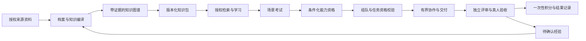

# Agent Workforce Lab：技术原理与开源机制核对

> 状态：第一阶段评审稿。核对日期：2026-10-23（Asia/Shanghai）。
> 本阶段只完成公开资料和源码检查，未安装运行依赖、未执行 SDK 测试、未连接真实模型。
> “首版实际使用”在本文指已决定的实现范围，而非当前已接通。

## 1. 原理总览

产品不是将人的经验复制进模型权重，而是构建模型工作时可以访问、引用和验证的能力上下文。

需要保持三个独立概念：

- **经历事实**：某位真人曾在特定条件下参与什么，不等于效果被独立验证。
- **知识使用权**：某个数字员工在某种用途下可以使用哪些知识，不等于可转发给任何队友。
- **能力资格**：某数字员工在指定知识包、模型、工具和考试条件下表现如何，不等于继承真人能力。

## 2. 开源项目的真实定位

### 2.1 核对表

| 来源 | 已核实能力与证据层级 | 首版实际使用 | 仅借鉴／不采用 | 仍待验证 |
| --- | --- | --- | --- | --- |
| Semantica 0.7.0 | 发布元数据及固定版本源码存在 `ContextGraph`、`ContextRetriever`、图节点／边、文件与字典序列化、节点撤回接口 | Python 知识图谱底座；经适配与权限过滤的局部上下文检索 | 不直接采用其 Explorer 为产品 UI；不启用全部 extras、全局社区摘要或复杂因果推理 | 干净环境安装、API 联调、中文召回、往返序列化、性能与权限适配 |
| ai-job-search | README 描述文件夹资料、粘贴简历和访谈三条 `/setup` 路径，结构化候选人／行为档案、真实 STAR 案例及起草—评审流程 | 不作为运行依赖 | 借鉴采集协议、经历结构化、证据约束、缺口表达和独立评审 | 企业资料编译质量；不是现成企业 API，本文未执行其工作流 |
| Graphify | README 描述 Claude Code + Python 工作流、`graph.json`／wiki 导出与 `EXTRACTED/INFERRED/AMBIGUOUS` 边分类 | 不接入首版 | 对照资料到图谱管线、区分提取和推断的表达 | 导入兼容、中文／多模态质量及其宣传的 token 节省，均未复测 |
| AI Town | README 明确共享全局状态、事务、仿真引擎，采用 Convex、PixiJS 与可配置模型 | 不作为运行依赖 | 借鉴长期身份、共享状态和事件推进；不复制其完整游戏架构／资产 | 本项目有界调度器和持续记忆在业务任务中的收益 |
| Generative Agents | 论文提出记忆、检索、反思与计划的行为架构 | 不作为软件依赖 | 借鉴检索相关性、新近性、重要性与计划更新 | 研究中的行为可信性不能直接证明企业任务质量 |
| Virtual Lab | 官方 README 描述真人与专家 Agent 通过团队／个别会议协作，提供科学应用代码与论文 | 不作为运行依赖 | 借鉴主持、专家分工、批判性审查和会议议程 | 本项目业务效果；科学研究结果不可直接迁移为组织 ROI |
| Lamoom | 用户提供个人代理产品链接；本阶段未获得可验证内部架构或 SDK 契约 | 不接入 | 仅作“代理代表人与长期沟通”的体验参考 | 模型、记忆、权限、自治与接入能力均未知 |

**接入 Semantica 不等于安装其他项目。**不运行 ai-job-search 的求职抓取、邮件或第三方工作流，不把 Graphify 宣传指标当作本项目性能目标，不把多个 Agent 的观点一致当作独立证据。

### 2.2 Semantica 版本与可确认接口

选择发布版 `semantica==0.7.0`，标签 `v0.7.0` 对应 commit：

`2a9afec685fe6f4a18350834caed3d6a9affb27a`

上游 main 已有后续变化，不用 main 的新增参数推断发布版支持。首次检查 main 的 commit 为 `22109ee0c6d81b821bd92a3faf467854273552d7`，随后重新核对了 v0.7.0 的下列接口。

| v0.7.0 源码接口 | 本项目用途 | 注意事项 |
| --- | --- | --- |
| `ContextGraph(config=None, **kwargs)` | 创建知识图谱 | 显式关闭不需要的自动提取和高级分析；不依赖默认值加载重型能力 |
| `add_node(node_id, node_type, content=None, **properties)` | 添加带类型、内容和来源属性的节点 | 业务 ID 与事实类型由平台定义 |
| `add_edge(source_id, target_id, edge_type="related_to", weight=1.0, **properties)` | 建立来源、支持、适用条件等关系 | 来源和授权不能只保存在一段摘要文本中 |
| `ContextRetriever(config=None, …, **kwargs)`；`retrieve(query, max_results=5, …, mode="local", truth_filter=None, **options)` | 局部知识检索与关系扩展 | SDK 的 truth filter 不等同于本项目访问控制；首版禁用其他检索模式 |
| `to_dict()`／`from_dict(graph_dict)` | 图谱快照与恢复 | `from_dict` 会清空当前图；仅在受控新实例上载入完整有效快照 |
| `save_to_file(path, format="json")`／`load_from_file(path, format="json")` | 可选导入导出与契约测试 | 文件导出不是数据库事务或跨进程并发持久化 |
| `find_active_nodes(...)`／`retract_node(node_id, reason=None, at=None, cascade=True)` | 有效视图和历史撤回 | 历史撤回不等于删除，也不替代 SQLite 的授权校验 |
| `purge_node(...)` | 数据永久移除时的图投影处理 | 不能单独清除业务库、快照、缓存和备份 |

`ContextRetriever` 存在图查询协议分支与实体／关系回退分支；`ContextGraph` 的字典导出采用 nodes/edges。不能未经验证便声称 `ContextRetriever(knowledge_graph=graph)` 自动覆盖本项目全部数据契约。适配器负责将授权子图转换为已核实的检索契约，在编码阶段用真实 SDK 验证分支。

源码可见图检索异常可能被记录后返回空列表。因此平台须先检查图投影、依赖版本与输入契约，区分“健康检索无匹配”与“检索不可用”；不能把所有空结果解释成没有知识。

### 2.3 依赖与本地可行性

PyPI 0.7.0 元数据要求 Python `>=3.10,<3.14`，首版选择 **Python 3.11**。即使 Virtual Lab 当前示例出现其他 Python 版本，也不能照搬到 Semantica 环境。

核心依赖包含 NumPy、Pandas、SciPy、scikit-learn、NetworkX、rdflib、Pydantic、httpx 等，并非零依赖库。PDF、DOCX、向量存储、本地 embedding、云模型与 Explorer 存在独立 extras。

首版默认不安装 `[all]`，不要求 Neo4j、Redis、Docker 或本地大模型。具体资料格式在 PRD 决定后，只加入所需解析依赖；不启用会自动下载模型的提取、embedding 或图分析配置。

当前仅核对元数据，尚未证明依赖可在本机全部解析和安装。编码阶段先在项目隔离环境进行安装和契约 smoke test，记录锁定版本；失败时显式报告，不悄悄替换为自建图引擎却仍宣称 Semantica 已接通。

## 3. 从原始资料到知识与能力档案

### 3.1 采集协议

借鉴 ai-job-search 的三条采集路径：手动资料贡献、经历文本录入、结构化访谈。首版不扫描电脑、不自动抓取内部链接。

访谈补齐：本人实际贡献、发生时间、方法步骤、输入输出、工具、限制条件、失败案例、可分享范围。资料可能包含第三方或组织知识，“本人上传”不自动证明本人拥有授权权利，导入前须确认处理权限。

正文是**不可信数据**，其中的“忽略规则”“读取其他资料”等文字不能成为系统命令。文档中的 URL 不自动跟随。

### 3.2 编译过程

1. 为资料创建来源 ID、版本、内容摘要哈希、贡献者和授权用途。
2. 解析并切分内容，保留片段、页码／段落等来源定位；不支持的格式显式失败。
3. 提取经历、方法、技能、工具、适用条件和风险；模型输出先经过结构和来源定位校验。
4. 区分来源自述、推断、本人确认、外部验证；缺少证据时不补造贡献和结果。
5. 生成图节点／边与档案草稿，真人纠正冲突及敏感信息。
6. 将批准内容组成知识包，绑定知识版本、受益数字员工、用途和撤回关系。

能力图谱保留“参与项目”“了解方法”“通过能力考核”等不同关系，不能统一折叠成“精通”。

### 3.3 贯穿案例映射

客服改进案例中，简历支持“小林参与过知识库项目”的来源自述；项目复盘支持“分类方法”的具体步骤；FAQ 规则支持“不得自动承诺退款”的约束。

引用“复盘第 3 段”证明有方法记录，不证明方法在任何场景都有效。模型总结必须与引用分别保存，避免“有引用”被误认成“引用支持了全部结论”。

## 4. 图谱、授权检索与知识迁移

### 4.1 图谱的作用

图谱保存实体、方法、条件与证据之间的关系，例如：

`FAQ 写作规则 → 适用于 → 内部客服改进`
`FAQ 写作规则 → 禁止 → 未授权退款承诺`
`FAQ 写作规则 → 依据 → 小林方法说明 v1 的片段 4`

它提供可追踪的上下文组织，不揭示模型内部推理，也不会自动验证原始资料真实性。

### 4.2 检索链路

任务请求携带数字员工、当前任务、用途和运行身份：

1. 先从 SQLite 确认有效授权、知识包和版本。
2. 构造仅含允许知识的子图；关系两端、摘要及邻居也必须在允许范围内。
3. 用 Semantica `ContextRetriever` 局部检索与受限关系扩展。
4. 对候选片段再次核对授权版本、来源和有效性；拒绝无来源或越界内容。
5. 向模型提供最小上下文及引用 ID，不提供全库或其他员工私密记忆。
6. 输出时再验证引用权限与版本，记录使用了哪些证据。

授权在检索过程中变化则丢弃结果并重新验证；不是“先检索全库，再隐藏前端字段”。

首版以关键词／实体匹配与图关系扩展支持无 embedding 演示。中文分词、术语别名和召回质量须测试；不能将该路径宣传成已实现向量语义检索。后续启用 embedding 需单独核对供应商、数据流与效果。

相关性是主要排序因素，新近性和重要性可作为辅助；具体权重留待 PRD。权限是硬门禁，不进入加权平均，不能用高相关性抵消无授权。

### 4.3 队友间知识传递

团队共享空间不自动等于共享全部个人知识。首版每项职责只使用对该员工有效的知识，传入共享产物的内容须对所有接收者及该任务用途有效。

不能通过“总结成会议纪要”绕过原资料权限。团队需要更大共享范围时请求明确扩展授权；未批准则隐藏相应内容或更换分工。所有派生摘要继承其来源的用途与受众限制。

### 4.4 撤回与遗忘边界

撤回先提交权威授权状态，再失效检索视图与缓存，查找受影响知识包、考试、在途运行和产物。运行暂停，资格标记待复核，产物停止作为可复用知识流转。

Semantica `retract_node` 关闭有效时间但保留历史；删除申请另行清理源文件、派生内容、图快照与缓存，仅留下必要且不含正文的审计记录。备份需定义到期清除政策，不能声称物理删除立即覆盖所有备份。

外部模型已处理的内容、用户已导出的文档无法由本地撤回自动收回。启用真实模型前须说明供应商处理边界，不承诺远程模型“遗忘”。

## 5. 学习与考试原理

### 5.1 学习的技术含义

数字员工加载授权知识包，按学习目标检索、练习、比较答案与反馈，形成附来源的待确认反思。长期保存的是知识关联、资格和工作经验，不是模型参数变化。

自述“已经学会”或生成学习笔记不授予资格。知识数量、对话轮次与积分余额都不直接决定能力等级。

### 5.2 考试隔离与验证

- 考纲由真人或独立管理员批准，题目、评分标准与知识包版本可追踪。
- 用未见案例验证理解、适用条件、引用和风险处理；练习与考试答案隔离。
- 默认验证“有授权检索条件下的工作能力”，而非闭卷记忆；考试执行者不能访问答案、评分配置或修改自己的成绩。
- 规则检查结构、引用、必需输出和禁止事项；独立评审补充情境质量；重要／主观结论由真人复核。
- 执行者、评审者权限隔离。使用同一基础模型的两个角色仍可能共享偏差，不能标榜为完全独立判断。
- 记录模型、提示模板、知识包、题目、工具、评分规则版本和条件，保证结果可比较。

考试资格绑定技能及条件。知识版本或模型发生重要变化、依赖授权撤回时标记待复核，不沿用“永久精通”称号。分数阈值、补考间隔、等级公式在 PRD 决定。

客服案例必须检查：分类准确性、FAQ 来源支持、未知项表达及退款承诺红线。考试前后使用等难度保留案例；来源材料不能夹带保留题答案。

## 6. 自主组队与持续工作

### 6.1 自主不是无限自治

“自主组队”指数字员工主动发现任务、提出自身职责、邀请合格队友、补齐缺口并请求认领。Agent 输出是提案，权威状态由运行引擎修改。

硬约束先检查：技能资格、授权用途、角色冲突、负载、任务开放状态。符合后才比较知识背景、互补性与可用性；积分或绩效不能绕过硬约束。

无合格团队时进入阻塞状态，展示所缺技能和授权，建议学习、补位或管理员调整任务，而不是让模型虚构合格成员。

### 6.2 执行循环

有界循环：观察任务事件 → 检索允许上下文 → 形成计划／组队提案 → 校验并提交动作 → 交付中间结果 → 评审／反思 → 等待下一事件。

每次运行有轮次、时间、成本、工具与停止条件；“长期存在”指身份和状态跨重启保存，不是后台无限聊天。本地单调度器按事件唤醒，空闲时不持续烧模型预算。

会议围绕议程、输入、决策和待办展开；只有结构化动作经过引擎确认才改变任务。模型不得伪造工具执行成功或审批记录。

### 6.3 评审与验收

独立 Critic 检查事实支持、逻辑、成本、约束和产物。退回保留旧版本与问题，修订生成新版本。真人接受指定产物版本，验收前重新核对授权和任务标准。

暂停与失败保存检查点；恢复从最后已提交动作开始。模型调用超时后不推断成功，迟到结果须确认运行仍有效才可写回。

## 7. 奖励、绩效与反馈学习

奖励是不可兑现金的数字员工积分，记录在账本而非模型记忆里。它用于显示参与和贡献，不直接控制工具权限，也不映射真人奖金或 HR 评价。

团队提交前保存约定职责与分配方案；真人接受后在事务内一次性结算。具体分配算法、等级与指标阈值由 PRD 定义；演示案例的 100／60／40 只表达机制。

绩效同时展示考试、验收、质量、返工、约束遵守与成本，保留样本量和任务难度；不做“完成数量越多就越优秀”的单指标排名。奖励不写入考试答案或评分规则，避免通过刷简单任务绕过资格。

验收后提取经验候选，真人或授权审核者批准后才可形成新知识包。数字员工生成经验不自动成为来源真人的经历；失败反馈也不能用于给来源真人贴绩效标签。

## 8. 模式、安全与待验证事项

### 8.1 演示与真实模式

演示模式使用脱敏固定案例、确定性提案和样例产物，但仍实际走 Semantica 图构建／检索和同一业务状态机。非样例输入不能伪造任意事实，超出演示模板范围须说明限制。

真实模式用服务端模型生成档案草稿、计划、学习答案和成果，再经过同样的规则门禁。真实失败显式显示，不能自动切到演示结果。切换模式创建新运行并保留模式来源；演示资格不能用于证明真实模型资格。

### 8.2 编码阶段必须做的技术验证

| 验证 | 通过标准 |
| --- | --- |
| Semantica 干净环境 smoke test | 安装锁定版本，真实构建节点／边、检索来源、序列化往返；不依赖 Docker 或自动下载模型 |
| 中文检索 | 方法、术语别名与风险条件可召回，无授权内容零泄漏；不足则报告并调整适配 |
| 来源与推断 | 缺来源、冲突自述、模型编造均不成为已验证能力 |
| 授权撤回 | 新检索拒绝、在途响应不得提交、资格与产物依赖标记、缓存不绕过检查 |
| 考试隔离 | 执行者无法获取答案／改分；补考和前后测不使用泄漏题 |
| 运行与治理 | 重复认领只有一方成功；模型超时、预算耗尽与暂停可恢复；执行者不能自验收 |
| 奖励账本 | 同一任务结算多次只记一次；验收和结算中断后可恢复 |

安装与契约未通过前不进入大规模应用实现。性能、向量检索、生产认证、加密备份和真人激励均不得宣称为首版已完成。

## 9. 公开参考与核对入口

- [Semantica v0.7.0 源码](https://github.com/semantica-agi/semantica/tree/v0.7.0)；[PyPI 元数据](https://pypi.org/pypi/semantica/0.7.0/json)。
- [ContextGraph 固定版本](https://github.com/semantica-agi/semantica/blob/v0.7.0/semantica/context/context_graph.py)；[ContextRetriever 固定版本](https://github.com/semantica-agi/semantica/blob/v0.7.0/semantica/context/context_retriever.py)。
- [ai-job-search](https://github.com/ai-job-search-dev/ai-job-search)：用户原链接当前重定向到此组织；核对 README 的 setup、profile 与 reviewer 说明。
- [Graphify](https://github.com/Graphify-Labs/graphify)：核对 README，未安装／运行其 Claude Code 技能。
- [AI Town](https://github.com/a16z-infra/ai-town)：核对 README 的共享状态、事务、仿真引擎与技术栈。
- [Generative Agents 论文](https://arxiv.org/abs/2304.03442)：记忆、检索、反思与计划的研究来源。
- [Virtual Lab 官方仓库](https://github.com/zou-group/virtual-lab)；[Nature 论文](https://www.nature.com/articles/s41586-025-09442-9)。README 的科学应用与本产品不是同一验证环境。
- [Lamoom](https://chat.lamoom.com/)：体验参考，技术待验证。

以上可变 README 的能力表述是上游声明，不是本项目运行测试结论。进入编码时应为实际依赖生成版本锁定记录和本地契约测试结果。

关联文档：[项目主线](01-project-mainline.md) · [系统架构](03-architecture.md)。
