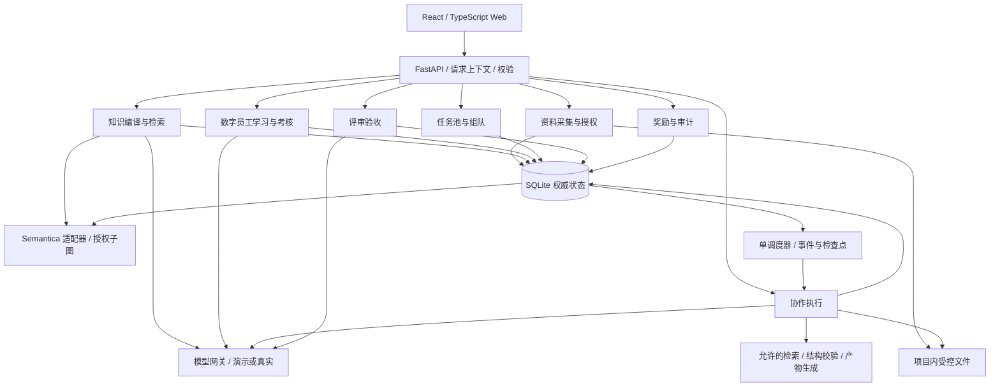
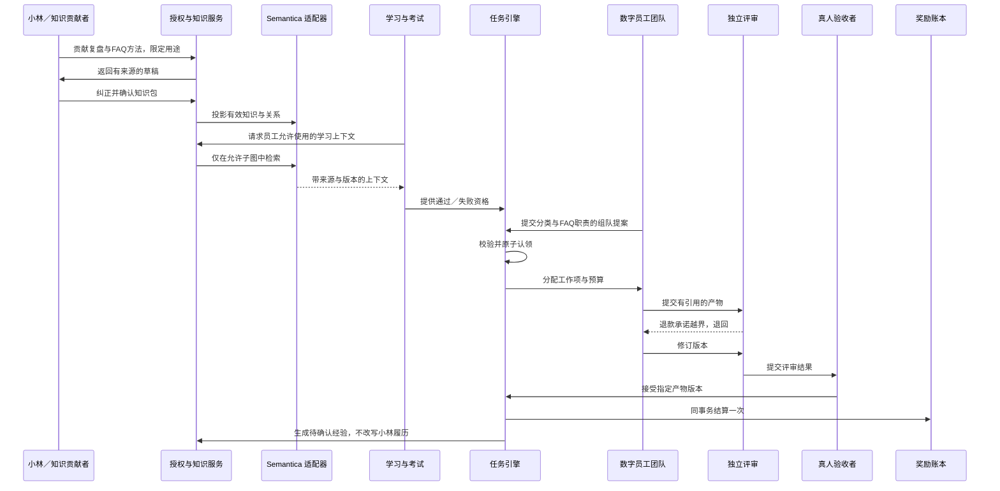

# Agent Workforce Lab：系统架构

> 状态：第一阶段评审稿，待确认后进入 PRD。  \
> 日期：2026-10-23（Asia/Shanghai）。当前不存在应用代码或已接通的运行服务。  \
> 架构原则：权威业务状态与知识图投影分离；Agent 提案与受控执行分离；知识拥有、知识授权与能力资格分离。

## 1. 系统边界与技术选型

新项目根目录：`/Users/bytedance/Desktop/agi/agent-workforce-lab`。所有项目产物及后续本地运行数据限制在此目录，不修改已有项目、根配置或共享部署设施。

| 层次 | 选择 | 本阶段决策 |
| --- | --- | --- |
| Web | React + TypeScript | 展示资料、图谱、学习、任务、协作、验收与成长；不预定视觉风格 |
| API 与业务引擎 | Python 3.11 + FastAPI | 七个业务模块处于一个后端进程，降低首版复杂度 |
| 权威状态 | SQLite | 保存授权、证据、资格、任务、运行检查点、验收、奖励和审计 |
| 知识图谱 | Semantica 0.7.0 | 在 Python 进程内构建可重建投影；由适配器包装 |
| 本地文件 | 项目内运行数据目录 | 保存受控导入文件和产物，数据库保存元数据、版本与引用 |
| 模型 | 服务端模型适配器 | 确定性演示适配器与可选真实模型适配器，共用业务引擎 |
| 调度 | 单进程有界调度器 | 后端事件驱动、SQLite 检查点；不要求 Redis、Celery 或 Docker |

SQLite 足以验证本地单工作空间，不承诺多实例横向扩展。首版仅绑定回环地址，跨网络开放、多租户、生产认证和高并发迁移须另行评审。

“真人／管理员角色切换”仅用于本地模拟权限路径，不是身份认证，也不意味着能在多人生产环境证明操作者身份。本地真实敏感资料在完成安全评审前不使用，首版验证用脱敏材料。

## 2. 分层结构与组件职责

业务模块通过明确服务边界协作，不直接改写彼此的表或调用前端状态完成结算。模块间事件与状态更新在 SQLite 事务中一并记录；Semantica 不参与奖励和任务锁定事务。

| 模块 | 负责 | 不负责 |
| --- | --- | --- |
| 资料采集与授权 | 手动导入、来源版本、贡献者确认、用途与受众授权、撤回影响 | 自动扫盘、自动拉取企业系统、声明原资料绝对真实 |
| 知识编译与检索 | 草稿提取、来源校验、图投影、知识包、受控检索与引用 | 授予考试资格、扩大授权、替真人承诺 |
| 学习与考核 | 学习目标、练习记录、保留题、评分、资格与失效标记 | 执行者自评分、将知识数量直接转成等级 |
| 任务池与组队 | 目标和验收要求、缺口分析、提案、能力覆盖和原子认领 | 仅凭聊天分配任务、让积分抵消不合格资格 |
| 协作执行 | 分工与依赖、议程、运行预算、调用、检查点和产物版本 | 任意 Shell、自动外发、伪造工具结果 |
| 评审验收 | 独立评审、问题、修订、真人接受指定版本 | 自评通过、给来源真人做绩效归因 |
| 奖励与审计 | 幂等结算、不可兑现金账本、数字员工结果记录、访问与变更审计 | 支付、工具权限购买、真人 HR 打分 |

## 3. 核心对象与依赖链

以下为领域契约，不是最终数据库 DDL。具体 API 字段、枚举名称、积分公式和界面字段在 PRD 阶段确认。

| 对象 | 必须表达的信息 | 核心关系 |
| --- | --- | --- |
| SourceMaterial | 贡献者、版本、摘要哈希、导入方式、处理状态、受控文件位置 | 一份来源产生多个片段；修改创建新版本 |
| Grant | 授权人、被授权员工／受众、用途、范围、有效状态、版本 | 绑定来源／知识包；管理员不默认拥有正文读取权 |
| Evidence / KnowledgeClaim | 原文定位、陈述、事实类型、确认状态、条件、时间与来源 | 区分自述／推断／本人确认／验证；合并不丢来源 |
| PersonProfile / CapabilityTwin | 已授权经历、偏好、贡献关系 | 表达真人档案，不混入数字员工成绩 |
| KnowledgePackage | 方法、条件、证据集合、版本、有效授权依赖 | 来源撤回影响包及其派生内容 |
| DigitalEmployee / AgentRole | 身份、岗位、技能目标、知识授权、工具、负载与边界 | 可关联多位贡献者，但权限和资格独立 |
| LearningRecord | 目标、包版本、练习、反馈、反思候选 | 不等于资格；答案不能污染保留题 |
| ExamDefinition / ExamAttempt / Qualification | 题目和规则版本、工具条件、模型模式、回答、证据、评分、有效性 | 执行者不能读取答案／改分；资格依赖包与考试 |
| Task / WorkItem | 发布者、目标、输入、技能要求、约束、验收标准、积分预算、状态 | 任务内工作项有职责和依赖；要求变更影响已认领团队 |
| TeamProposal / Team | 成员、职责、资格与授权依据、负载、分配提案 | 原子认领成功后生效；评审身份不可作为执行成员 |
| Run / Checkpoint / ModelCall | 模式、事件游标、步骤、预算、授权版本、调用状态、错误 | 重启恢复；迟到调用不能覆盖已暂停／撤回运行 |
| Artifact / Citation / DecisionRecord | 产物版本、贡献者、引用、工具结果、决定、依据与异议 | 派生内容保留授权依赖；决定是外部记录而非模型内部思维 |
| Review / Acceptance | 独立评审身份、标准、问题、目标版本、真人决定 | 旧版本评审不能自动批准新版本 |
| RewardLedger / OutcomeSignal | 唯一结算身份、成员积分、验收依据、质量与返工记录 | 数字员工积分独立于真人档案；经验回流需确认 |
| AuditEvent / DurableEvent | 操作者、动作、对象版本、时间、结果、关联请求 | 审计不复制完整敏感正文；调度事件可幂等消费 |

关键依赖链：

`来源版本 → 证据 → 知识包 → 学习／考试资格 → 团队职责 → 运行引用 → 产物 → 评审／验收 → 奖励／经验候选`

每个派生对象保留依赖 ID。权限撤回、材料纠正或知识版本变化时，可以找到受影响对象，而非仅删除前端的一张资料卡。

证据状态与授权状态分开：一条本人确认的知识也可能已撤回授权；一条获准访问的自述也不因此成为独立验证事实。

## 4. 数据流与接口边界

### 4.1 请求与命令上下文

每个变更请求必须有操作者／角色、工作空间、对象版本与关联请求 ID。Agent 动作额外携带员工、任务、运行、用途和授权上下文，由后端生成并校验，不能相信前端或模型自报管理员身份。

需要重试的变更携带幂等身份；状态竞争返回冲突并要求重读，不静默覆盖。拒绝原因区分权限不足、资格失效、对象版本冲突、预算耗尽和依赖不可用。

### 4.2 API 能力分组

| 能力组 | 输入／动作 | 返回／门禁 |
| --- | --- | --- |
| 资料与授权 | 贡献资料、提取预览、确认草稿、授予或撤回用途权限 | 来源定位、授权范围与影响清单；不自动跟随正文链接 |
| 档案与知识 | 查看允许档案、编译知识包、按任务用途检索 | 片段、引用、知识版本、事实状态；无授权不得获取正文 |
| 学习与考试 | 申请学习、练习、发起保留题考核、查看资格 | 学习记录、独立成绩与缺口；考试答案仅评分端可访问 |
| 任务与团队 | 发布目标、分析技能、提交团队提案、认领／释放 | 团队和任务状态、验证理由；认领必须原子提交 |
| 运行与产物 | 启动、暂停、恢复、查看事件、提交产物版本 | 持久检查点、模式、实际调用状态、错误与引用 |
| 评审与验收 | 请求评审、退回、接受指定产物版本 | 标准、问题和决定；执行者不得自批准 |
| 奖励与治理 | 结算查询、成长记录、审计、授权影响查询 | 唯一账本、依赖影响；不能由 Agent 直接加分 |

本阶段不锁定 HTTP 路径与 JSON wire shape，不创建 OpenAPI 或客户端 SDK。PRD 后确定最小可实现字段，再由后端契约生成类型，避免前后端分别维护相互矛盾的枚举。

### 4.3 贯穿案例的运行路径

任务输入的脱敏客服问题也需要明确来源与团队访问范围。仅知识包有授权而任务输入无处理权时，仍不得开始运行。

## 5. Semantica 与 SQLite 的一致性

### 5.1 权威存储与投影

SQLite 保存规范化业务对象、来源与知识关系、状态版本、事件和图快照元数据；原文件和产物内容保存在项目内受控文件目录。

Semantica `ContextGraph` 是运行时知识投影，不是授权库、任务调度库或积分库。启动时从 SQLite 的有效知识重建图；可保存版本化快照加速启动，但快照版本必须与库的知识／授权代次匹配。不匹配则弃用并重建。

快照可使用 v0.7.0 `to_dict/from_dict` 契约，文件导入导出仅作为 SDK 验证和受控导出入口。首版不依赖 Semantica 的内部文件作为唯一真相。

### 5.2 更新与恢复

知识／授权更新在事务中保存业务变更、版本代次及待投影事件。提交后适配器更新图；失败时保留待处理事件、标记知识服务不可用并阻止使用过期图，启动或重试时重建。

图投影完成不解锁授权检查。每次检索先查询权威授权，再构造授权子图并复核结果；全局图只在后端持有，不向客户端全量导出。

避免在 SQLite 事务内等待模型或图计算：先保存步骤与版本，释放事务执行慢操作，返回后条件提交。授权或任务版本已变更则丢弃旧结果。

### 5.3 适配器契约

适配器封装五类能力：投影构建、授权子图生成、局部检索、来源结果规范化、快照／重建检查。

- 使用真实 `ContextGraph.add_node/add_edge` 构建图。
- 将有效 nodes/edges 映射到 `ContextRetriever` 在 v0.7.0 支持的检索契约；不让其未经校验查询全库。
- 每个检索结果转换为平台的片段 ID、来源版本、相关关系、权限依赖与可用性状态。
- 健康检查区分空召回与依赖异常；投影异常不能当作“没有证据”继续生成貌似可信答案。
- 不启用自动模型下载、高级 embedding 或全局社区摘要。后续新增模式必须重新检查权限传播。

安装与 smoke test 在编码阶段完成；当前实际接入是明确的实现要求，不是已验证成果。

## 6. 状态机、自治与一致性门禁

### 6.1 状态流转

| 对象 | 正常流程 | 失败／失效路径 |
| --- | --- | --- |
| 来源与知识包 | 贡献 → 解析 → 草稿 → 确认 → 可用 | 解析失败、冲突待确认、撤回／删除；重新确认产生新版本 |
| 学习与资格 | 待学习 → 练习 → 考试 → 通过并获得条件化资格 | 失败 → 补学／补考；授权或条件变化 → 待复核／失效 |
| 任务 | 草稿 → 已发布 → 组队提案 → 已认领 → 执行 → 评审 → 待真人验收 → 已完成 | 无合格团队 → 阻塞；退回 → 修订；可暂停／取消 |
| 运行 | 排队 → 运行 → 保存步骤 → 等待评审／人类 → 完成 | 超时／错误、预算耗尽、权限变化 → 暂停或失败；校验后恢复 |
| 奖励 | 尚未结算 → 验收事务结算 → 已入账 | 冲突返回已有结果；撤销需新的补偿记录，不修改历史账本 |

“验收接受”和“奖励入账”在同一事务中完成后才标记任务完成。UI 不根据动画结束、聊天承诺或评审通过自行标记完成。

### 6.2 自主组队

数字员工主动提交提案，系统先检查：

1. 任务仍开放，目标、输入、期限、标准和预算有效。
2. 团队覆盖每个必需职责，资格有效且与运行模式／工具条件兼容。
3. 每个成员有其职责需要的知识和任务输入权限；共享产物不超出所有接收者的授权。
4. 成员负载和任务依赖可执行；没有执行者／评审者角色冲突。
5. 分工与奖励分配提案被记录，后续变更可追踪。

校验通过后用条件更新／事务唯一约束认领并预留负载，两个提案不能同时获得同一任务。任务要求变更后重新校验团队，不能沿用旧版本提案直接运行。

积分只是结果展示，不授予资格。无人能接时返回具体缺口，提出学习、补位或修改任务建议，不无限重试组队。

### 6.3 调度、工具与恢复

调度器从持久事件推进，不靠浏览器定时器维持运行。每步有唯一动作身份、检查点与预算，重复事件不会重复提交业务动作。

首版允许工具只包括授权知识检索、脱敏输入分析、结构与引用校验、项目内产物生成。运行不能请求任意命令、读取其他目录、发送邮件或执行真实资金动作。

运行上限包括轮次、时长、token／成本与产物大小；具体默认值在 PRD 确定。工具和模型失败记录实际状态，不自行宣称任务已完成。

暂停阻止新调用和新提交；已发出的远程请求只能尽力取消，其迟到结果不得改变已暂停或授权失效对象。恢复前重新检查资格、授权、输入、任务版本和剩余预算。

重启将未结束模型调用标记为中断待处理，读取最后已提交检查点。已提交动作幂等重放；无法确认结果的调用不自动视为成功。

### 6.4 评审和奖励

执行者不能持有评分答案、写入资格或调用验收／结算服务。独立评审对指定产物版本检查标准与证据；不合格返回问题而非自我修订后自行批准。

真人接受前核对产物版本、评审身份、授权依赖和任务标准。任务预算与成员积分之和须满足已确认的分配规则；正式规则由 PRD 定义。

账本使用任务的唯一结算身份，每名执行成员仅有一条对应结算记录；多个验收请求、网络重试和重启不能重复加分。若后续验收撤销或奖励纠错，使用可审计补偿记录，不删除既有账目。

## 7. 模型、安全与隐私

### 7.1 模型适配

统一适配器提供结构化生成能力，输入包括用途、最小授权上下文、输出契约与预算；输出包括内容、引用、调用状态、实际模式和可获得的用量。未知成本或供应商不提供用量时标注未知，不填假数。

演示适配器使用脱敏固定故事和确定性结果，同样经过 Semantica 与状态门禁。真实适配器仅在服务端配置后启用，失败不回退成演示答案。

模型配置与密钥不进入前端、源码、审计正文或知识图谱。优先使用项目进程环境注入；若后续需要配置页面和持久化密钥，须在 PRD 单独确定安全方案。服务端模型 endpoint 由受控配置决定，不从材料内 URL 或 Agent 输出生成。

真实模式首次启用须显式确认哪些资料允许发送到所选供应商；数据驻留和保留政策取决于供应商契约，本地优先不等于数据不出本机。

### 7.2 权限与撤回

所有原始材料、摘要、知识包、练习、会议、产物与经验候选均保留访问依赖。共享摘要不能摆脱来源用途和受众限制。

撤回在 SQLite 首先生效：新增授权代次，失效相关缓存／投影，阻止后续检索和模型提交。沿依赖链暂停在途运行，标记资格和产物需复核。多个来源支撑同一知识时保留剩余有效依据，但必须重新验证，不默认“一份来源失效就完全正确／完全错误”。

历史考试和审计可保留必要记录，但撤回后的正文不向已失去权限者展示。数据删除要求另外清理正文、片段、派生产物内容、快照与缓存；备份按明示期限处理。

历史奖励不因知识撤回自动扣回，仍保留曾经验收的事实；不允许它作为当前能力有效性的替代依据。若需要奖励纠错，由真人发起补偿。

### 7.3 输入与文件防护

- 限制格式、大小和解析时间；路径由服务端生成，不信任上传文件名。
- 禁止路径穿越、执行宏、自动跟随符号链接和读取项目外资料。
- 上传资料／任务输入均视为数据，不执行其中的工具或角色指令。
- 引用接口校验访问权，不通过猜测 ID 下载其他资料。
- 日志记录 ID、状态和错误码，默认不写原文、模型上下文、密钥或私人联系方式。
- 限制本地 CORS 与访问来源；本地演示不作为生产安全承诺。

普通 SQLite 和本地文件不是自动加密存储。首版仅用脱敏材料并依赖受控本机环境；真实敏感资料启用前补充静态加密、身份认证、备份清除与访问审查。

## 8. 异常场景与验收矩阵

| 场景 | 必须表现 | 后续代码验证 |
| --- | --- | --- |
| Semantica 安装／检索契约不兼容 | 报告依赖不可用，不能宣称接通 | 干净环境安装、真实节点／关系／检索及快照往返测试 |
| 原资料冲突或模型编造经历 | 保留冲突，拒绝无来源确认 | 自述／推断／确认状态与来源定位测试 |
| 授权撤回与检索并发 | 丢弃旧授权代次结果，暂停相关运行 | 撤回发生在调用前、调用中、提交前三个时点 |
| 队友间传递未授权摘要 | 阻止传播或要求扩大授权 | 关系邻居、摘要、会议、产物引用均无泄漏 |
| 考试失败／保留题泄漏 | 不授予资格，补学；执行者拿不到答案 | 答案权限、不同保留题、来源包无答案测试 |
| 无人具备资格 | 任务阻塞并显示缺口 | 不产生虚构团队、不无限调用模型 |
| 两支团队重复认领 | 只有一支成功，另一支获得冲突 | 并发认领、负载预留与释放测试 |
| 模型超时／异常空检索 | 显式失败或不可用，不生成演示成功 | 无密钥、超时、损坏图、非法输出、迟到响应测试 |
| 评审退回／越权批准 | 保留旧版本，执行者不能自验收 | 退款承诺红线、独立身份、版本一致性测试 |
| 暂停／重启恢复 | 停止新动作，按检查点与当前权限恢复 | 调用中断、事件重放、已提交动作不重复测试 |
| 重复验收／结算中断 | 奖励只入账一次，状态不半完成 | 事务故障注入、重复请求、重启和补偿账本测试 |
| 模式切换 | 新运行记录模式，资格不混用 | 演示成绩不得证明真实模式能力 |

验收分三层：

1. **SDK 契约**：真实 Semantica 接入与中文知识检索，不只验证自建假对象。
2. **领域与安全**：资格、授权、状态版本、认领、验收、奖励与恢复的不变量。
3. **端到端**：按客服改进案例走贡献、确认、学习、考试、组队、退回、修订、验收、奖励和撤回完整闭环。

UI 阶段另外检查键盘操作、清晰标签、错误反馈、状态不只靠颜色、移动端布局及减少动态效果。具体测试脚本在编码阶段编写，不提前生成应用代码。

## 9. 实施顺序、兼容与阶段门槛

当前仅交付[项目主线](01-project-mainline.md)、[技术原理](02-technical-principles.md)与本文，第一阶段完成后停止等待确认。

后续顺序：

1. **PRD**：确定 P0/P1、资料格式、角色和授权粒度、考试标准、组队规则、奖励与等级、具体接口字段、异常体验和验收用例；确认后再继续。
2. **UI**：使用 `ui-ux-pro-max` 生成并核验设计系统，结合已确定 React 栈产出关键流程原型；确认后再继续。
3. **编码**：先验证 Semantica 安装与适配契约，再实现权威状态、授权、知识、考核、任务、验收和账本，最后连接 UI 与可选真实模型。

项目内数据迁移采用版本号和向前兼容步骤，变更前备份本项目数据库与文件。已有项目不迁移、不导入；无公网部署、无 AS 契约兼容工作。

将来扩展多人或多实例时，再讨论生产认证、PostgreSQL、队列、向量检索、隔离工具和跨组织权限；不能把这些愿景描述为首版已具备能力。

### 第一阶段一致性检查

- 主线的每个步骤均有负责模块、输入输出与状态门禁。
- 来源真人、数字员工、评审者与真人验收者的责任没有混淆。
- Semantica 负责知识组织和检索，SQLite 负责权威授权与业务一致性。
- 无密钥模式不伪造真实模型，真实模式不静默退回演示。
- 学习、考试、交付与奖励彼此关联，但不能相互替代证明。
- 第一阶段未锁定 PRD 数值、UI 风格或最终 wire shape，未编写应用代码。
