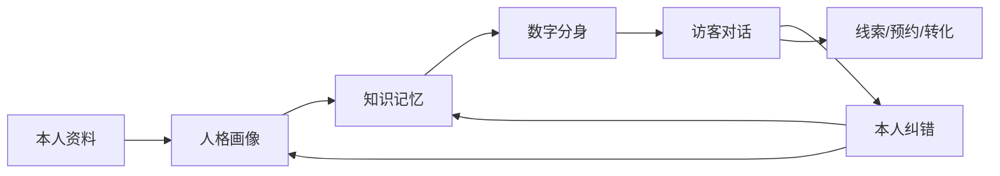
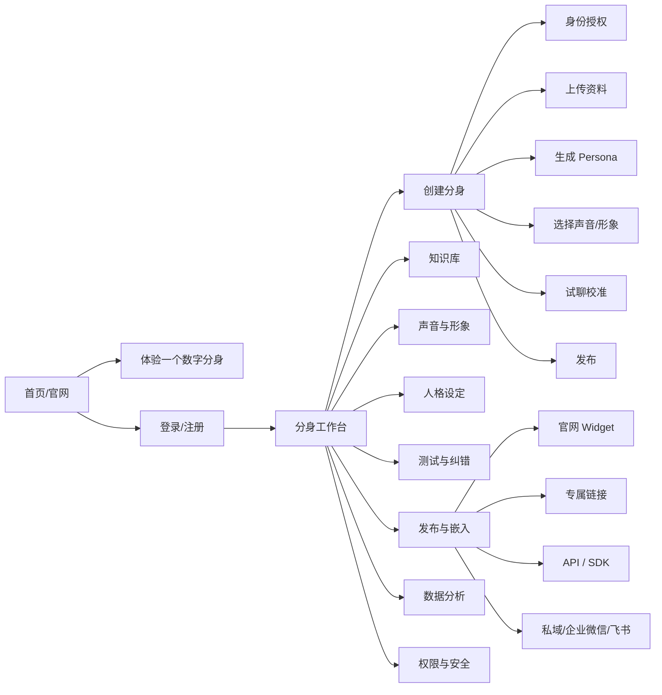
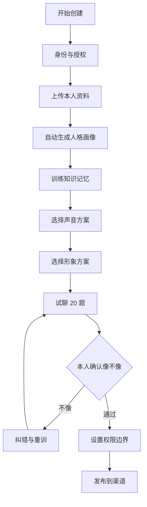

# 数字分身产品设计方案

## 1. 产品定位

产品暂名：`TwinOS` / `分身工作台` / `Persona Agent`

一句话定位：

> 帮创始人、专家、销售、老师、IP 主理人创建一个“像本人、有记忆、能对话、可授权办事”的 AI 数字分身。

目标不是只生成一个会动的头像，而是建立从本人资料、人格建模、知识记忆、对话交互、纠错训练到授权办事的完整闭环。

## 2. 目标用户

| 用户类型 | 核心诉求 | 典型场景 |
|---|---|---|
| 创始人 | 替自己回答高频问题、筛选线索 | 官网接待、投资人/客户问答 |
| 专家/顾问 | 扩大咨询服务半径 | 付费问答、课程答疑、预约咨询 |
| 销售/客服团队 | 降低重复沟通成本 | AI SDR、售前答疑、客户分流 |
| 老师/教练 | 提供陪练和持续反馈 | 学习陪伴、口语教练、职业辅导 |
| IP 主理人 | 和粉丝规模化互动 | 粉丝问答、内容推荐、私域转化 |

## 3. 核心产品闭环



## 4. 产品信息架构



## 5. 核心页面设计

### 5.1 分身工作台 Dashboard

目标：让创作者知道自己的分身是否可用、像不像、有没有风险。

顶部信息：

- 当前分身：某某的 AI 分身
- 发布状态：未发布 / 测试中 / 已发布
- 形态：文字 / 语音 / 视频
- 一键体验

主区域：

- 分身完成度
- 本人相似度测试：语气、知识、边界
- 最近对话
- 待确认高风险请求
- 用户最常问问题
- 推荐补充资料

产品重点：不要只显示“训练完成”，而要显示“像不像、安全吗、能不能发布”。

### 5.2 创建分身流程



建议创建流程分为 6 步：

1. 身份授权：明确本人授权创建 AI 分身。
2. 资料导入：支持上传文章、PDF、Notion、X 链接、播客转录、视频字幕、FAQ。
3. 人格画像生成：总结身份、表达风格、核心观点、禁区、常用例子。
4. 声音/形象配置：先支持默认声音、克隆声音、静态头像、实时视频头像。
5. 分身测试：系统自动生成 20-50 个测试问题。
6. 发布：支持链接、网站嵌入、API、私域渠道。

### 5.3 Persona Builder

这个页面是数字分身的灵魂。

| 区块 | 功能 |
|---|---|
| 身份声明 | 分身是谁，如何介绍自己 |
| 语气风格 | 正式/轻松/犀利/温和/幽默 |
| 价值观 | 长期稳定的判断原则 |
| 表达样例 | 本人真实表达样本 |
| 禁止事项 | 不代表本人承诺、不回答隐私等 |
| 回复边界 | 不确定时怎么说 |
| 纠错记录 | 本人修正过哪些回答 |

建议增加一个“像我程度调节器”：

```text
保守准确  ←────────────→  风格拟真
```

- 靠左：更像知识库助手，不乱说。
- 靠右：更像本人语气，但幻觉风险更高。

### 5.4 知识库

知识库不要只做文件列表，而应该做成“分身记忆库”。

资料权限建议分级：

| 权限 | 含义 |
|---|---|
| 公开可答 | 访客可以问，分身可以直接回答 |
| 半公开 | 可以概括，不能引用原文 |
| 私密记忆 | 只影响风格和判断，不直接透露 |
| 禁止使用 | 不进入分身上下文 |

页面能力：

- 上传资料
- 自动摘要
- 主题聚类
- 来源可信度
- 更新时间
- 是否允许对外回答
- 是否允许引用原文
- 是否只给内部使用
- 一键生成 FAQ
- 一键生成测试集

### 5.5 测试与纠错

每次回答后，本人可以标注：

```text
✅ 正确且像我
⚠️ 正确但不像我
❌ 错误
🚫 不该回答
✍️ 我会这样说
```

纠错后系统更新：

- 人格规则
- RAG 权重
- 禁止回答策略
- 反例测试集
- 风格样本库

### 5.6 访客对话端

访客端建议支持三种形态：

#### 文字 Widget

适合官网、文章页、个人主页。

- 右下角悬浮入口
- 明示“我是某某的 AI 分身，不是本人实时在线”
- 推荐问题
- 文本对话
- 来源引用
- 转人工/预约本人

#### 语音对话

适合陪练、顾问、教育、销售。

- 大按钮：按住说话 / 实时语音
- 状态：正在听 / 正在思考 / 正在回答
- 用户开口自动打断
- 对话结束自动生成纪要

#### 视频数字人

适合高价值展示、销售、客服、IP 个人站。

- 中央数字人视频
- 底部语音输入
- 右侧资料卡/推荐问题
- 显示 AI 分身标识
- 可切换文字/语音/视频

## 6. MVP 范围

### MVP 必做

| 模块 | 功能 |
|---|---|
| 分身创建 | 上传资料、生成 Persona |
| 知识库 | 文件上传、网页导入、RAG 检索 |
| 对话 | 文字对话 |
| 语气模仿 | system prompt + examples |
| 纠错 | 本人标注回答、更新规则 |
| 发布 | 分享链接、网页嵌入 |
| 安全 | AI 身份声明、敏感问题拒答 |

### V1 增强

| 模块 | 功能 |
|---|---|
| 语音 | ASR + TTS + 流式播放 |
| 声音 | 本人声音克隆 |
| 评测 | 自动生成测试集 |
| 分析 | 热门问题、满意度、未答问题 |
| 权限 | 公开/私密资料分级 |
| 工具 | 预约日历、收集线索 |

### V2 高级

| 模块 | 功能 |
|---|---|
| 视频 | 实时 Avatar |
| 多渠道 | 微信/飞书/网站/API |
| Agent | 发邮件草稿、CRM 写入、工单处理 |
| 长期记忆 | 用户画像、跨会话记忆 |
| 商业化 | 按使用量计费、团队版 |
| 合规 | 水印、审计、授权证明 |

## 7. 产品差异化

### 分身相似度评测

不要只展示“训练完成”，而是给出：

```text
知识准确度：86
表达相似度：79
边界安全性：93
可发布指数：82
```

### 本人纠错闭环

每次本人纠错都会变成：

- 新规则
- 新记忆
- 新反例
- 新测试题

### 权限分身

同一个人可以有多个版本：

| 分身版本 | 用途 |
|---|---|
| 公开版 | 官网访客、粉丝、普通用户 |
| 客户版 | 售前、咨询、线索收集 |
| 团队版 | 内部知识、管理风格、决策辅助 |
| 私人版 | 自我复盘、个人助理 |

### 高风险动作确认

分身可以帮本人做事，但不能直接越权。

示例：

> 我不能代表本人做投资承诺，但可以帮你整理项目介绍，并提交给本人查看。
