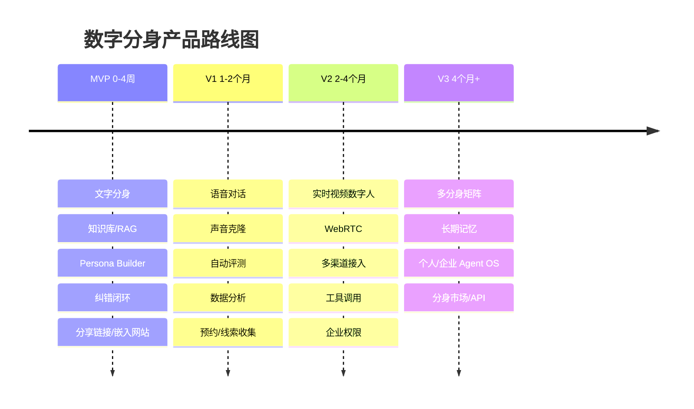

# 数字分身产品路线图

## 1. 总体路线

## 2. MVP：文字分身

周期：0-4 周

目标：证明“分身像本人”，并能带来初步业务价值。

核心交付：

- 创建分身
- 上传资料
- 自动生成 Persona
- 建立知识库/RAG
- 文字对话
- 本人纠错
- 分享链接
- 官网嵌入 Widget
- 基础安全边界

验收标准：

- 用户能在 10 分钟内创建一个可对话分身。
- 分身能回答本人公开资料中的高频问题。
- 本人能纠正错误回答，并在后续回答中生效。
- 对明显越权请求能拒答。
- 可通过链接或脚本嵌入外部页面。

## 3. V1：语音分身

周期：1-2 个月

目标：让分身从“聊天机器人”变成“可自然交流的语音代理”。

核心交付：

- ASR 语音输入
- TTS 语音输出
- 流式播放
- 用户打断
- 声音克隆
- 自动评测
- 热门问题分析
- 预约/线索收集

验收标准：

- 语音首包小于 1.5 秒。
- 用户打断后 500ms 内停止当前输出。
- 能生成对话纪要和线索摘要。
- 声音体验自然，无明显机械感。

## 4. V2：视频数字人

周期：2-4 个月

目标：把分身升级为实时视频 Agent，适合高价值展示、销售、客服和 IP 私域。

核心交付：

- 实时 Avatar 接入
- WebRTC 音视频链路
- 口型同步
- 视频会话状态管理
- 多渠道接入
- 工具调用
- 企业权限
- 审计日志

验收标准：

- 视频首帧小于 2.5 秒。
- 端到端回答延迟 2-4 秒。
- 支持文字/语音/视频三种形态切换。
- 支持高风险工具调用确认。

## 5. V3：Agent OS

周期：4 个月+

目标：从单个数字分身升级为个人或企业的 Agent 操作系统。

核心交付：

- 多分身矩阵
- 多角色权限
- 长期用户画像
- 跨会话记忆
- 分身市场
- API / SDK
- 团队知识库
- 企业合规策略

验收标准：

- 一个主体可创建多个不同权限的分身。
- 分身可接入多个业务系统。
- 支持团队管理、审计和权限隔离。
- 可作为第三方应用的数字人/分身能力底座。

## 6. 优先级建议

第一版不要追求酷炫视频，而是先把这三个体验打透：

1. 回答像本人。
2. 不乱编、不越权。
3. 能带来真实业务价值，例如线索、预约、咨询转化。

等“人格 + 记忆 + 纠错”闭环成立后，再接入实时语音和视频 Avatar。
