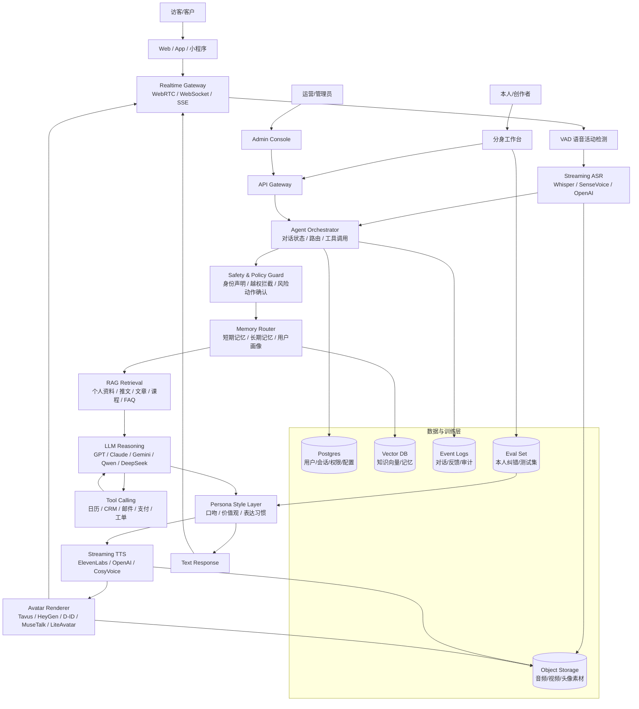
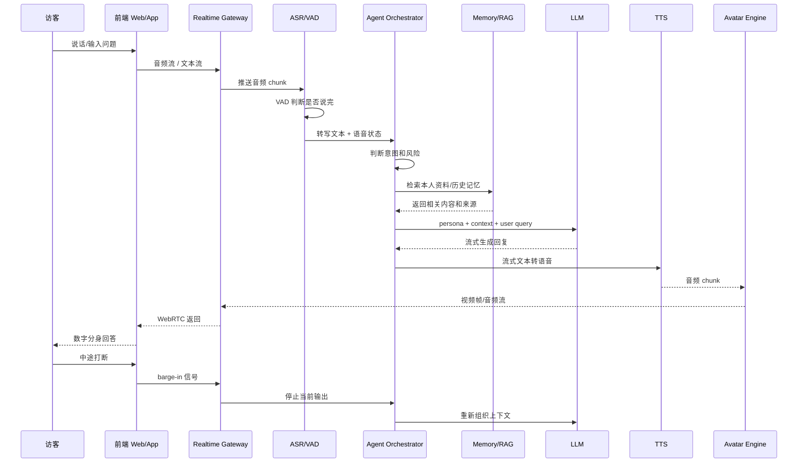
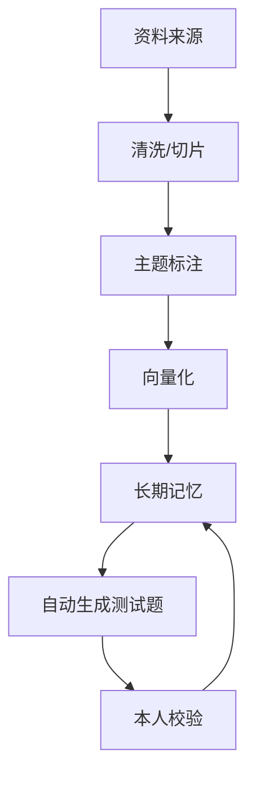

# 数字分身技术架构

## 1. 总体架构

数字分身不是一个单一模型，而是一条实时多模态 Agent 流水线：

```text
用户输入 → 听懂/看懂 → 分身大脑 → 生成回复 → 语音合成 → 口型/表情/视频驱动 → WebRTC/网页/应用输出
```

总体架构由 7 层构成：

1. 身份与授权层
2. 知识与记忆层
3. 对话 Agent 层
4. 声音层
5. 形象/视频层
6. 实时通信层
7. 安全与产品边界

## 2. 总体技术架构图



## 3. 实时对话链路



## 4. Agent Orchestrator 职责

`Agent Orchestrator` 是系统中最重要的编排层，负责：

- 判断用户意图：闲聊、问知识、请求操作、高风险请求。
- 判断是否检索：是否需要进入个人知识库或长期记忆。
- 判断是否调用工具：日历、CRM、邮件、工单、支付等。
- 控制回复形态：文字、语音、视频。
- 管理对话状态：多轮上下文、打断、重试、澄清。
- 记录反馈：把本人纠错转化成规则、记忆和测试样本。
- 执行安全策略：越权拦截、高风险操作确认、隐私保护。

## 5. 数据与记忆设计

### 5.1 数据来源

- 公开内容：X/Twitter 历史推文、博客、Newsletter、视频、播客、访谈。
- 私有内容：笔记、文档、邮件、聊天记录。
- 业务内容：产品文档、CRM、FAQ、客服知识库。
- 人格材料：价值观、表达样例、禁区、个人经历。

### 5.2 记忆类型

| 记忆类型 | 说明 | 示例 |
|---|---|---|
| 短期记忆 | 当前会话上下文 | 用户刚刚问过什么 |
| 长期事实记忆 | 稳定个人事实 | 经历、作品、公司、项目 |
| 语义记忆 | 观点和知识 | 对 AI Agent 的判断 |
| 情节记忆 | 发生过的事件 | 上次和某客户聊了什么 |
| 程序记忆 | 做事方式 | 如何筛选线索、如何回复合作请求 |
| 风格记忆 | 表达习惯 | 常用比喻、语气、禁用表达 |

### 5.3 知识处理流程



## 6. 推荐技术选型

### 快速 MVP

```text
前端：Next.js / React
实时：WebSocket / SSE，后续 LiveKit
大脑：OpenAI / Claude / Gemini
RAG：Supabase pgvector / Qdrant
声音：OpenAI TTS / ElevenLabs
Avatar：先不自研，后续接 Tavus / HeyGen / D-ID
部署：Vercel + 后端 API
```

### 中文自托管方案

```text
ASR：FunASR / SenseVoice / Whisper
LLM：Qwen / DeepSeek / GPT
TTS：CosyVoice / GPT-SoVITS / Fish Speech
Avatar：MuseTalk / Wav2Lip / LiteAvatar / SadTalker
实时：FastAPI + WebSocket / LiveKit
RAG：Qdrant / Milvus / pgvector
前端：React / Vue
部署：GPU 服务器 + Docker
```

### 商业实时视频方案

```text
Realtime Infra：LiveKit / Daily / Agora
Avatar Provider：Tavus / HeyGen / D-ID / Simli / Synthesia
TTS：ElevenLabs / OpenAI / Cartesia
LLM：GPT / Claude / Gemini
Memory：Postgres + Vector DB
Safety：Policy Guard + Audit Logs
```

## 7. 实时体验指标

| 指标 | 建议目标 |
|---|---:|
| 首次文字响应 | < 1 秒 |
| 语音首包 | < 1.5 秒 |
| 视频首帧 | < 2.5 秒 |
| 端到端回答 | 2-4 秒 |
| 可打断响应 | < 500ms |
| ASR 准确率 | 中文场景优先优化口语、噪声、人名 |

## 8. 安全策略

数字分身必须默认具备以下安全能力：

- 明示“我是某某的 AI 分身，不是本人实时在线”。
- 肖像权、声音权和数据授权记录。
- 高风险动作确认，例如投资承诺、财务承诺、法律建议、医疗建议。
- 隐私保护，避免透露私人联系方式、内部资料、未授权数据。
- 审计日志，记录关键对话和工具调用。
- 输出水印或身份标识。
- 本人可随时暂停、下线、删除或重训分身。

## 9. 实现难点排序

1. 像本人的判断方式：需要本人资料、结构化人格、反例和持续纠错。
2. 实时低延迟：ASR、LLM、TTS、口型、WebRTC 每层都会增加延迟。
3. 视频自然度：唇形、眨眼、微表情、头部运动和情绪同步都影响真实感。
4. 打断能力：没有 barge-in 会显得非常机械。
5. 记忆可靠性：数字分身不能胡编本人经历，需要来源、置信度和时间戳。
6. 授权和安全：特别是声音克隆和真人形象。
7. 成本：实时视频 Avatar + TTS + LLM 的并发成本较高。
